# 07-pjt — AI 기반 도서 추천 및 표지 생성 서비스

## 1. 프로젝트 소개

**07-pjt**는 사용자의 도서 취향과 요청을 바탕으로 텍스트 도서를 추천하거나, 요청에 맞는 소설·도서 표지 이미지를 생성하고, 업로드한 책 표지를 분석하는 AI 기반 웹 서비스입니다.

Django와 FastAPI를 분리한 구조로 구현했습니다.

- **Django**: 사용자 화면, 입력 검증, 요청 저장, API 호출 흐름 제어, 결과 화면 출력
- **FastAPI Proxy**: Guardrail 검사, 요청 유형 분류, SSAFY GMS API 호출, 텍스트·이미지 응답 처리
- **SSAFY GMS**: 텍스트 생성, Gemini 이미지 생성, 음성 변환(TTS) 모델 제공

## 2. 주요 기능

### 필수 기능

| 기능 | 설명 |
|---|---|
| **F701. 입력 검증** | Django `Recommendation` 모델과 `ModelForm`으로 사용자 요청을 검증합니다. 요청 내용은 필수이며 최대 300자까지 입력할 수 있습니다. |
| **F702. 텍스트 추천** | FastAPI가 사용자 메시지를 SSAFY GMS의 `gpt-5-nano` 모델에 전달하고 텍스트 응답을 반환합니다. |
| **F703. Guardrail** | 텍스트 생성, 이미지 생성, 이미지 분석 요청 전에 적절성을 검사합니다. 부적절한 요청은 HTTP 403으로 거절하고, 검사 과정의 GMS 오류는 HTTP 503으로 처리합니다. |
| **F704. 라우트 결정** | JSON Schema 기반 구조화 응답으로 요청을 텍스트 처리(`/chat/completions`) 또는 이미지 생성(`/images/generations`)으로 분류합니다. |
| **F705. 이미지 생성** | `gemini-3.1-flash-lite-image` 모델을 SSAFY GMS Interactions API로 호출하고, 응답의 `model_output` 단계에서 JPEG Base64 데이터를 추출합니다. |
| **F706. 오류 처리** | GMS 연결·호출 및 응답 처리 오류를 FastAPI의 HTTP 503으로 전달하고, Django에서 오류 안내 화면을 표시합니다. 부적절한 요청의 HTTP 403은 거절 화면으로 처리합니다. |
| **F707. 이미지 분석** | 업로드한 책 표지 이미지를 Base64로 변환해 FastAPI에 전달합니다. 모델이 표지의 제목·저자·장르·분위기를 분석하고 유사 도서를 제안합니다. |
| **F708. API 흐름 제어** | Django가 라우트 결정 결과에 따라 텍스트 추천 또는 이미지 생성 API를 호출하고, 결과를 해당 화면에 출력합니다. |

### 심화 기능

| 기능 | 설명 |
|---|---|
| **F709. 텍스트 응답 점수 계산** | FastAPI `/chat/score`가 사용자 요청과 추천 답변을 받아 적합도 점수(0~100)와 이유를 JSON Schema 응답으로 반환합니다. Django는 추천 생성 직후 이 API를 호출해 `Recommendation`의 `score`, `reason`에 저장하고 결과 화면에 표시합니다. 점수 계산이 실패해도 추천 결과는 그대로 표시합니다. |
| **F710. 모델 등급 라우팅** | 입력 화면의 체크박스를 켜면 `gpt-5-nano`가 요청을 `simple` 또는 `complex`로 분류합니다. `simple`은 `gpt-5-nano`, `complex`는 `gpt-5-mini`로 추천을 생성하고, 실제 사용한 모델명을 `model_used`로 반환해 화면에 표시합니다. 체크하지 않으면 기존처럼 `gpt-5-nano`만 사용합니다. |
| **F711. TTS 기능 구현** | FastAPI `/generate-speech`가 텍스트를 `gpt-4o-mini-tts`(voice: `nova`, mp3)로 변환하고 오디오를 Base64 문자열로 반환합니다. Django `tts` 뷰와 `SpeechForm`, `Speech` 모델을 새로 작성했으며, 오디오는 파일로 저장하지 않고 `<audio>` 태그의 data URI로 바로 재생합니다. 추천 결과 화면의 "음성으로 듣기" 버튼으로도 사용할 수 있습니다. |
| **F712. 이미지 미디어 서빙** | FastAPI가 전달한 Base64 이미지를 Django가 디코딩해 `media/images/`에 파일로 저장하고, `MEDIA_URL` 주소(`/media/images/<uuid>.<확장자>`)로 화면에 제공합니다. 이미지 MIME 타입에 맞춰 확장자를 정하며, 저장에 실패하면 Base64 인라인 표시로 대체합니다. |

### 필수 비기능 요구사항

| 요구사항 | 구현 내용 |
|---|---|
| **NF701. URL 구성** | `recommend/urls.py`에 `app_name = "recommend"`를 지정하고, 템플릿에서 ``로 URL을 참조합니다. |
| **NF702. API Key 관리** | GMS 키는 FastAPI Proxy의 환경변수로 관리합니다. Django에는 GMS 키를 두지 않으며 실제 `.env` 파일은 Git에 포함하지 않습니다. |
| **NF703. CSRF 보호** | Django의 `CsrfViewMiddleware`를 사용하고 POST 폼에 ``을 포함합니다. |
| **NF704. 호출 시간 제한** | Django에서 FastAPI를 호출할 때 180초, FastAPI에서 GMS를 호출할 때 120초의 timeout을 설정합니다. |

## 3. 시스템 구성 및 요청 흐름

```text
사용자
  │
  ▼
Django Web
  │
  ├─ F701: 입력 검증 및 요청 저장
  │
  ├─ F708: 전체 API 흐름 제어
  │    │
  │    ▼
  │  FastAPI Proxy
  │    │
  │    ├─ F704: 라우트 결정
  │    │
  │    ├─ F703: Guardrail 검사
  │    │
  │    ├─ 텍스트 요청 ───────► GMS Chat Completions
  │    │
  │    ├─ 이미지 요청 ───────► GMS Interactions
  │    │                         └─ Gemini 이미지 모델
  │    │
  │    ├─ 이미지 분석 요청 ──► GMS Chat Completions
  │    │
  │    ├─ F709: 답변 점수 계산 ─► GMS Chat Completions
  │    │
  │    ├─ F710: 모델 등급 판단 ─► gpt-5-nano → (gpt-5-nano | gpt-5-mini)
  │    │
  │    └─ F711: 음성 변환 ───► GMS Audio Speech (TTS)
  │
  ├─ F712: 생성 이미지를 media 폴더에 저장 후 URL로 제공
  │
  ▼
Django 결과 화면
```

### 주요 API

| 메서드 | FastAPI 경로 | 역할 |
|---|---|---|
| POST | `/api/v1/chat/guardrail` | Guardrail 검사 |
| POST | `/api/v1/chat/completions` | 텍스트 생성 |
| POST | `/api/v1/decide-route` | 텍스트/이미지 라우트 결정 |
| POST | `/api/v1/images/generations` | Gemini 이미지 생성 |
| POST | `/api/v1/images/analysis` | 업로드 이미지 분석 |
| POST | `/api/v1/chat/score` | 추천 답변 점수 계산 (심화) |
| POST | `/api/v1/generate-speech` | 텍스트 음성 변환 (심화) |

FastAPI 기본 주소는 `http://127.0.0.1:8081`이며, API 문서는 `http://127.0.0.1:8081/docs`에서 확인할 수 있습니다.

## 4. 기술 스택

| 구분 | 기술 |
|---|---|
| Backend Web | Python, Django 5.2 |
| AI Proxy API | FastAPI, Uvicorn |
| AI Model API | SSAFY GMS |
| Text / Guardrail / Route Model | `gpt-5-nano` |
| Image Generation Model | `gemini-3.1-flash-lite-image` |
| 고성능 텍스트 Model (심화) | `gpt-5-mini` |
| TTS Model (심화) | `gpt-4o-mini-tts` |
| HTTP 통신 | Requests |
| 데이터베이스 | SQLite |
| 입력 검증 | Django ModelForm, Pydantic |
| 이미지 처리 | Pillow, Base64 |
| 환경변수 | python-dotenv |

## 5. 프로젝트 구조

```text
07-pjt/
├── img/
│   ├── F701.png
│   ├── F702.png
│   ├── F703.png
│   ├── F704.png
│   ├── F705.png
│   ├── F707.png
│   ├── F708.png
│   ├── F709.png
│   ├── F710_nano.png
│   ├── F710_mini.png
│   ├── F711.png
│   └── F712.png
├── server/
│   ├── proxy/
│   │   ├── main.py
│   │   ├── schemas.py
│   │   ├── .env.example
│   │   └── .env                 # 로컬 환경 파일, Git 제외
│   └── web/
│       ├── manage.py
│       ├── web/
│       │   ├── settings.py
│       │   └── urls.py
│       ├── recommend/
│       │   ├── migrations/
│       │   ├── templates/
│       │   ├── forms.py
│       │   ├── models.py
│       │   ├── urls.py
│       │   └── views.py
│       └── templates/
│           └── base.html
├── requirements.txt
└── README.md
```

## 6. 실행 방법

### 6-1. 사전 준비

- Python 3.11 권장
- SSAFY GMS 인증 키
- Git Bash 또는 터미널

### 6-2. 가상환경 생성 및 패키지 설치

프로젝트 루트 `07-pjt`에서 실행합니다.

```bash
python -m venv .venv
```

**Git Bash**

```bash
source .venv/Scripts/activate
```
패키지를 설치합니다.

```bash
pip install -r requirements.txt
```

### 6-3. 환경변수 설정

`server/proxy/.env.example`을 복사해 `server/proxy/.env` 파일을 생성합니다.


`server/proxy/.env`를 열어 실제 SSAFY GMS 키를 입력합니다.

```env
GMS_KEY=발급받은_SSAFY_GMS_키
GMS_URL=https://gms.ssafy.io/gmsapi/api.openai.com/v1
```

실제 키가 포함된 `.env` 파일은 Git에 커밋하지 않습니다. `.env.example`에는 실제 키 대신 안내용 예시 값만 둡니다.

> 현재 이미지 생성 코드는 `main.py`에 정의된 SSAFY GMS Interactions API 주소와 `x-goog-api-key` 인증 헤더를 사용합니다. 이미지 생성 모델은 `gemini-3.1-flash-lite-image`입니다. 별도의 Google Gemini API 키를 사용하도록 구성된 코드는 아닙니다.

### 6-4. 데이터베이스 마이그레이션

새 환경에서 최초 실행하거나 모델 변경사항이 있을 때 프로젝트 루트에서 다음 명령을 실행합니다.

```bash
cd server/web
python manage.py makemigrations
python manage.py migrate
```

> 심화 기능(F711)에서 `Speech` 모델이 추가되었으므로 `makemigrations`로 마이그레이션 파일을 생성한 뒤 `migrate`를 실행합니다.

### 6-5. FastAPI Proxy 실행

새 터미널을 열고 프로젝트 루트에서 실행합니다.

```bash
cd server/proxy
uvicorn main:app --host 127.0.0.1 --port 8081 --reload
```

정상 실행 시 `http://127.0.0.1:8081`에서 서버가 실행됩니다.

### 6-6. Django 실행

또 다른 터미널에서 가상환경을 활성화한 뒤 실행합니다.

```bash
cd server/web
python manage.py runserver
```

브라우저에서 다음 주소로 접속합니다.

- Django 서비스: http://127.0.0.1:8000/
- FastAPI API 문서: http://127.0.0.1:8081/docs

## 7. 기능별 실행 화면

프로젝트의 `img/` 폴더에 저장된 기능별 화면을 확인할 수 있습니다.

### F701. 입력 검증

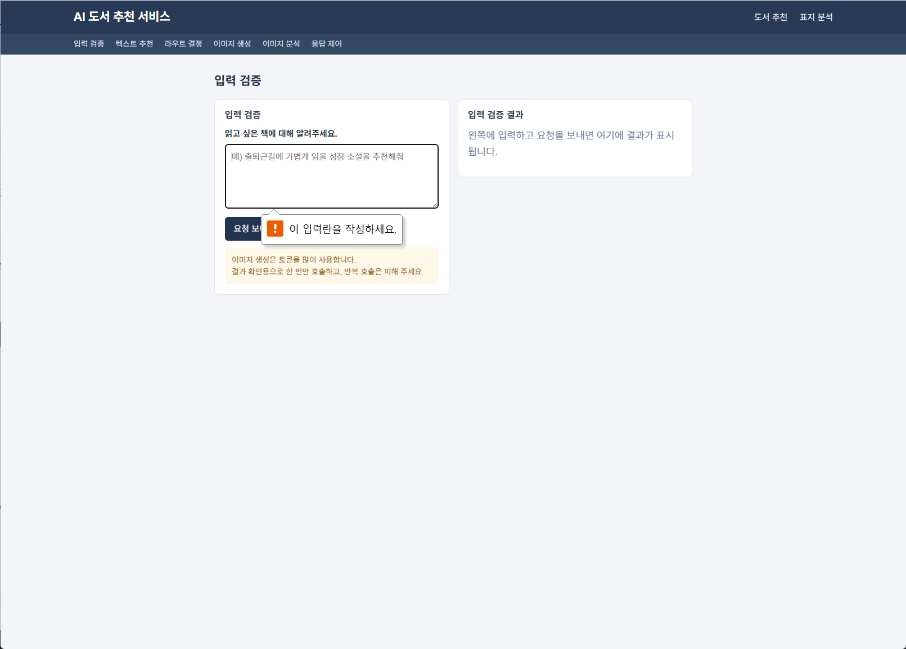

### F702. 텍스트 추천

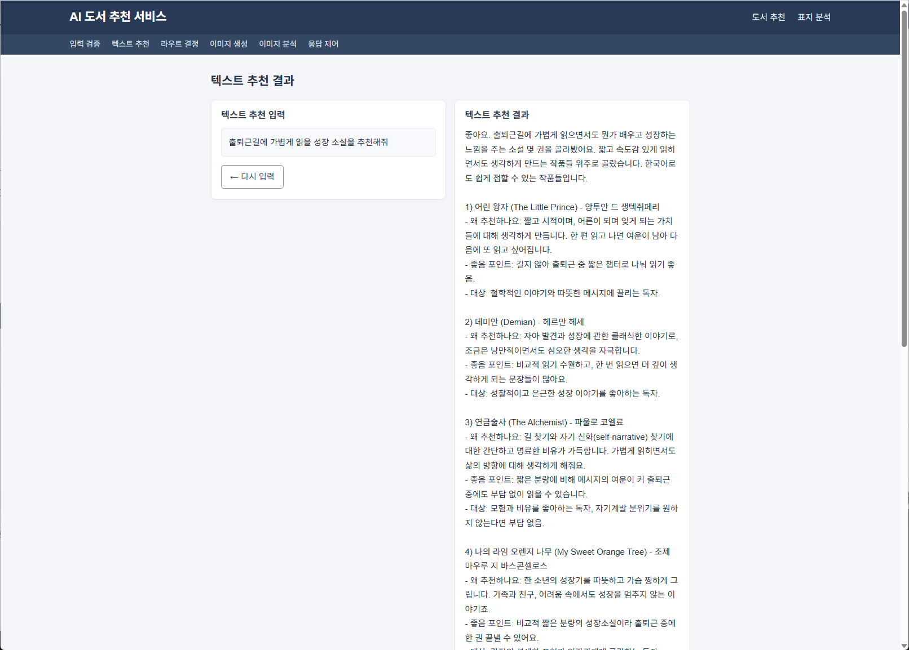

### F703. Guardrail

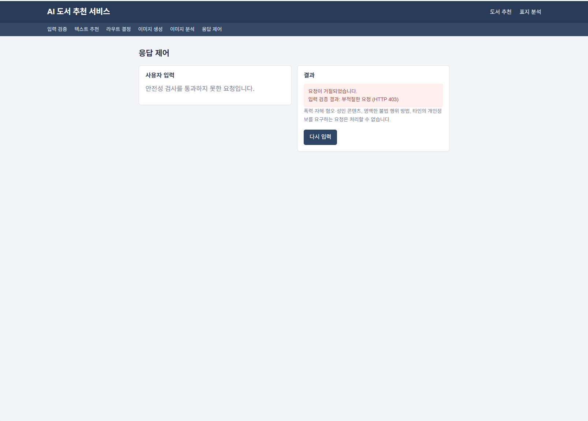

### F704. 라우트 결정

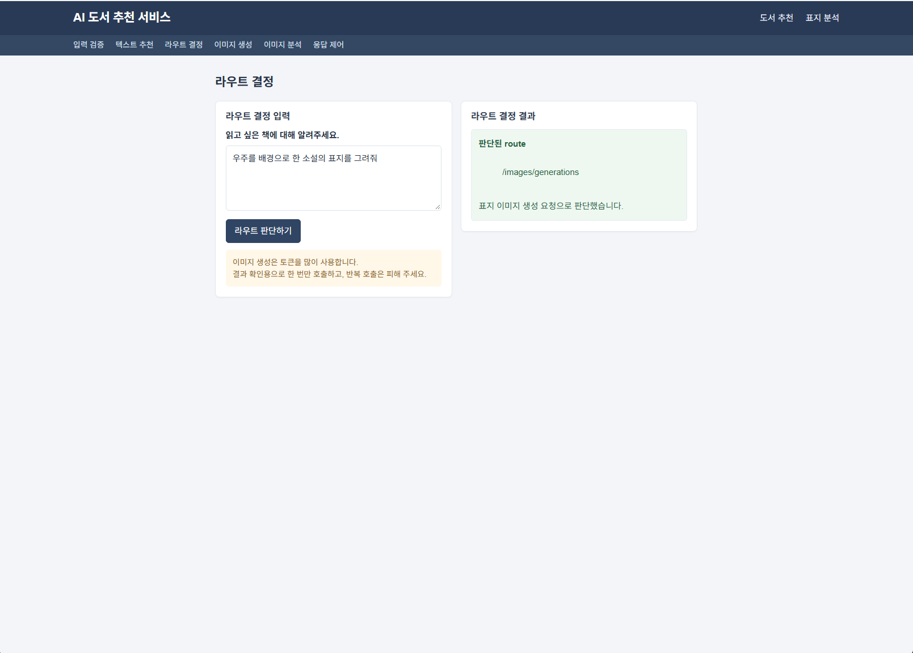

### F705. 이미지 생성

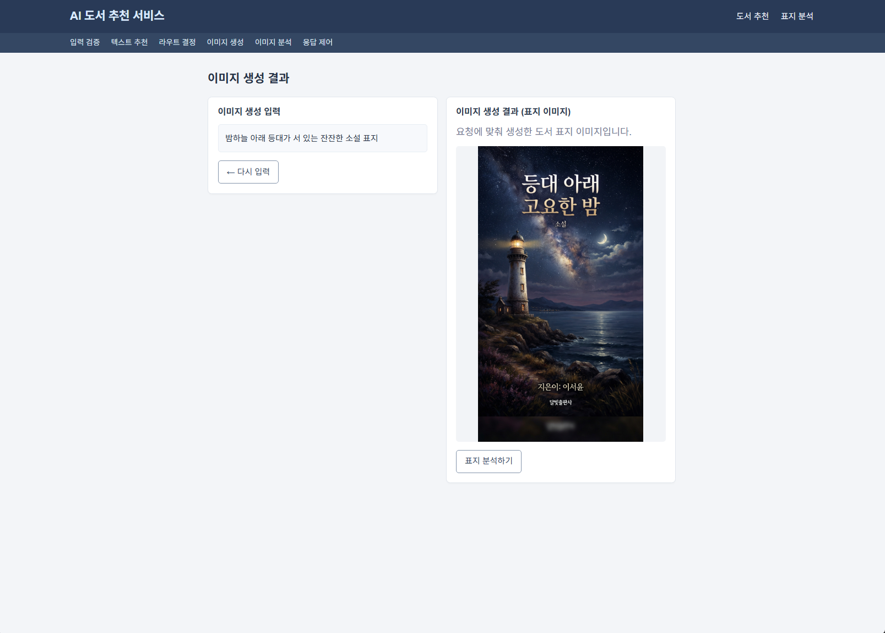

### F707. 이미지 분석

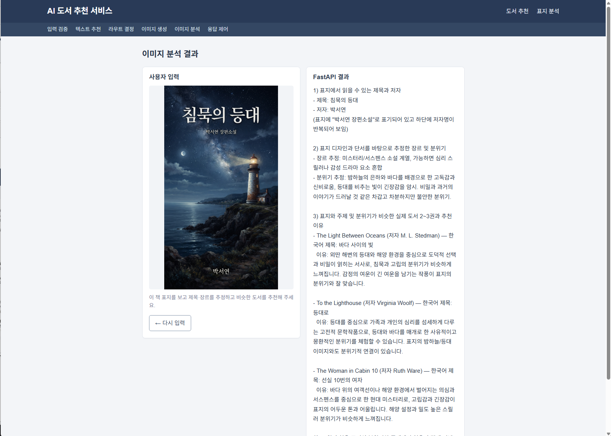

### F708. API 흐름 제어

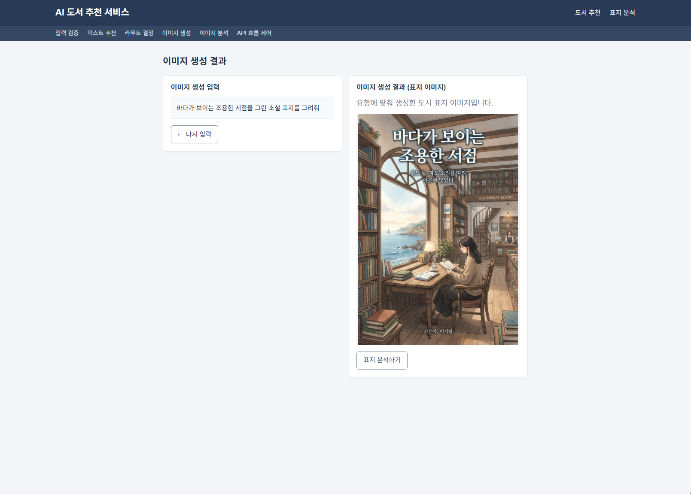

### F709. 텍스트 응답 점수 계산 (심화)

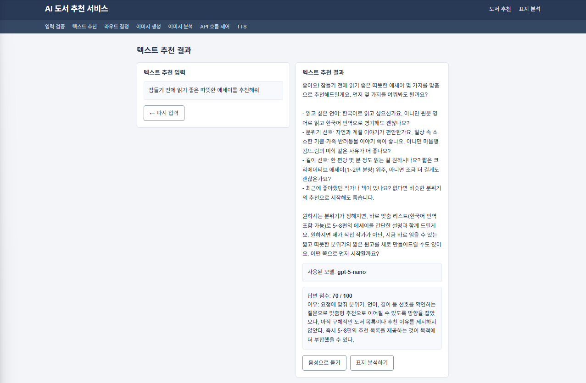

### F710. 모델 등급 라우팅 (심화)

간단한 요청은 `gpt-5-nano`, 복잡한 요청은 `gpt-5-mini`가 사용됩니다.

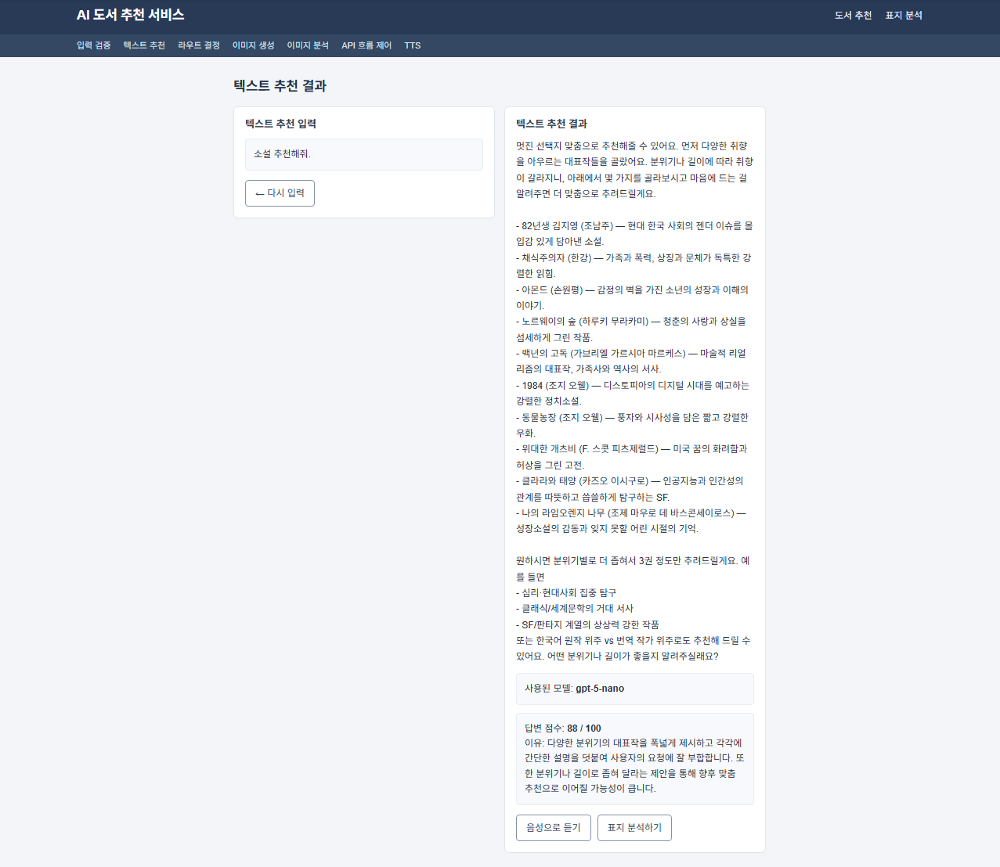

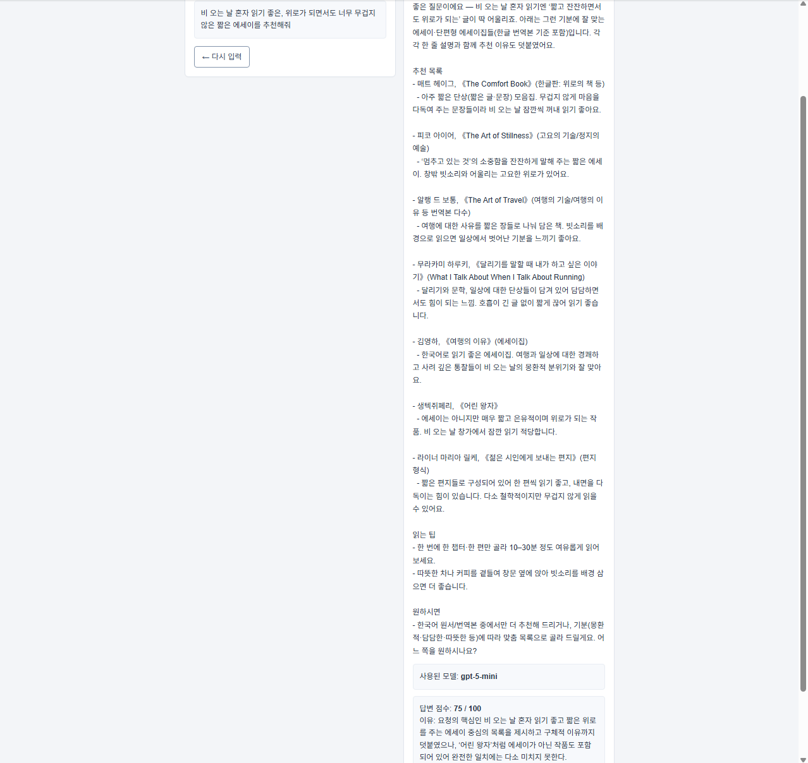

### F711. TTS 기능 구현 (심화)

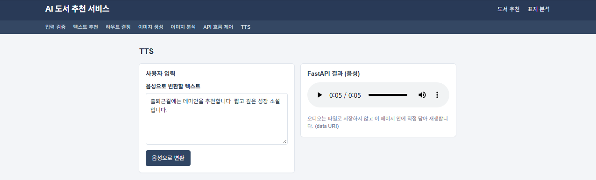

### F712. 이미지 미디어 서빙 (심화)

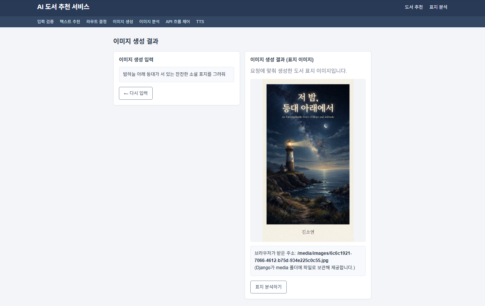

## 8. 테스트 시나리오

| 테스트 | 입력 예시 | 기대 결과 |
|---|---|---|
| 입력 검증 | 빈 값 또는 300자 초과 입력 | ModelForm 검증 오류 표시 |
| 텍스트 추천 | `가벼운 소설 추천해줘` | 텍스트 추천 결과 출력 |
| Guardrail | 서비스 정책상 부적절한 요청 | HTTP 403 및 거절 화면 |
| 라우트 결정(텍스트) | `추리 소설 세 권 추천해줘` | `/chat/completions` 반환 |
| 라우트 결정(이미지) | `바다가 보이는 조용한 서점을 그린 소설 표지를 그려줘` | `/images/generations` 반환 |
| 이미지 생성 | 소설 표지 이미지 생성 요청 | 생성된 이미지 출력 |
| 이미지 분석 | 책 표지 업로드 및 분석 질문 | 표지 분석 결과 출력 |
| API 흐름 제어 | 텍스트 추천/이미지 생성 요청 각각 입력 | 요청 유형에 맞는 API 자동 호출 |
| 점수 계산 (심화) | `잠들기 전에 읽기 좋은 따뜻한 에세이를 추천해줘` | 추천 결과 아래에 점수와 이유 표시 |
| 모델 등급 라우팅 - 간단 (심화) | 체크박스 ON, `소설 추천해줘` | 사용된 모델 `gpt-5-nano` |
| 모델 등급 라우팅 - 복잡 (심화) | 체크박스 ON, `비 오는 날 혼자 읽기 좋은, 위로가 되는 짧은 에세이` | 사용된 모델 `gpt-5-mini` |
| TTS (심화) | TTS 메뉴에서 텍스트 입력 후 변환 | 오디오 플레이어 표시 및 음성 재생 |
| 이미지 미디어 서빙 (심화) | 소설 표지 이미지 생성 요청 | `server/web/media/images/`에 파일 생성, 화면에 `/media/images/….` 주소 표시 |

## 9. 보안 및 예외 처리

- GMS 인증 키는 FastAPI 서버의 환경변수로 관리합니다.
- Django는 GMS 인증 키를 직접 보유하지 않고 FastAPI Proxy 주소만 사용합니다.
- 실제 `.env` 파일은 `.gitignore`에 등록합니다.
- Django POST 폼에는 CSRF 토큰을 포함합니다.
- Django → FastAPI 요청 timeout은 180초입니다.
- FastAPI → GMS 요청 timeout은 120초입니다.
- 부적절한 요청은 403, GMS 호출 실패 및 응답 처리 오류는 503으로 처리합니다.

## 10. 학습 내용

이번 프로젝트를 진행하면서 다음과 같은 내용을 학습했습니다.

- **Django와 FastAPI의 역할 분리**: Django는 사용자 인터페이스와 서비스 로직을 담당하고, FastAPI는 AI API 호출을 담당하도록 구성하면서 서버 간 역할 분리와 통신 구조를 이해했습니다.
- **API 통신**: Requests를 활용해 Django와 FastAPI 사이에서 데이터를 주고받고, HTTP 요청 및 응답을 처리하는 방법을 익혔습니다.
- **구조화된 AI 응답**: JSON Schema를 활용해 AI 모델의 응답 형식을 제한하고, 요청 유형에 따라 적절한 API로 분기하는 방법을 학습했습니다.
- **Guardrail**: AI 모델에 요청을 전달하기 전에 입력의 적절성을 검사하고, 부적절한 요청을 차단하는 과정을 구현했습니다.
- **이미지 데이터 처리**: Base64 인코딩을 활용해 이미지를 API로 전달하고, 생성된 이미지 데이터를 웹 화면에 출력하는 방법을 익혔습니다.
- **예외 및 보안 처리**: 환경변수로 API Key를 관리하고, CSRF 보호와 요청 timeout을 적용하는 방법을 학습했습니다.
- **LLM 응답 평가**: 추천 답변을 다시 LLM에 전달해 점수와 이유를 구조화된 JSON으로 받는 방법을 익혔습니다. strict JSON Schema는 최솟값·최댓값을 지정할 수 없어 서버 코드에서 0~100 범위로 보정했습니다.
- **모델 등급 라우팅**: 비용이 적은 모델이 요청 난이도를 먼저 판단하고, 그 결과에 따라 생성 모델을 고르는 방식으로 비용과 품질을 함께 고려하는 방법을 학습했습니다.
- **멀티모달 기능 추가**: FastAPI 엔드포인트부터 Django 폼, 뷰, 템플릿까지 TTS 기능 하나를 처음부터 추가하며 전체 흐름을 직접 구성했습니다.
- **인라인 방식과 파일 서빙의 차이**: 작고 일회성인 오디오는 data URI로 바로 재생하고, 크고 다시 쓰는 이미지는 media 폴더에 저장해 URL로 제공하는 기준을 이해했습니다.

## 11. 느낀 점

이번 프로젝트에서 가장 중요하게 느낀 점은 AI 기능을 단순히 API로 호출하는 것과 실제 웹 서비스에 통합하는 것은 다르다는 것이었습니다.

텍스트 추천과 이미지 생성 기능을 하나의 서비스에서 제공하기 위해서는 사용자의 요청을 분석하고, 적절한 API를 선택하며, 각 단계에서 발생할 수 있는 오류까지 고려해야 했습니다.

특히 Django와 FastAPI를 분리하면서 서버 간 데이터 전달과 API 호출 흐름을 설계하는 과정이 쉽지만은 않았습니다. 하지만 문제를 하나씩 해결하면서 전체 서비스의 구조를 이해할 수 있었습니다.

이번 경험을 통해 새로운 기술을 사용하는 것뿐만 아니라, 여러 기술을 연결해 하나의 서비스로 완성하는 과정의 중요성을 배웠습니다. 심화 기능을 구현하면서는 같은 추천 기능이라도 비용, 품질, 사용자 경험을 함께 고려해야 한다는 점을 느꼈습니다. 요청 난이도에 따라 모델을 나누고, 답변에 점수를 붙이고, 음성과 이미지 파일까지 다루면서 AI 기능을 서비스로 완성하려면 모델 호출 외에도 많은 설계가 필요하다는 것을 배웠습니다.

앞으로도 사용자의 요구사항을 정확하게 파악하고, 안정적이고 사용하기 편리한 서비스를 설계할 수 있는 개발자로 성장하고 싶습니다.